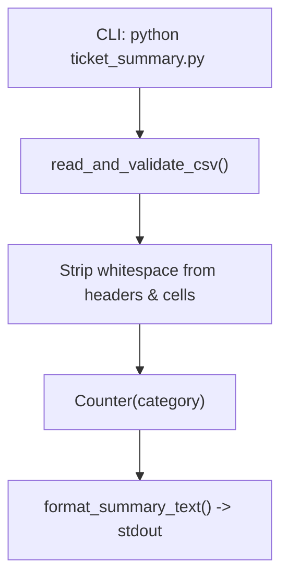

# PR 01: Baseline CLI Runner and Category Count Summary

**Branch:** `feat/01/baseline-cli-and-category-counts` -> `dev`  
**Ticket:** [01-baseline-cli-and-category-counts.md](file:///C:/Users/saila/Documents/BITCOT_TASK/Python-ticket-summary-tool/.scratch/ticket-summary/issues/01-baseline-cli-and-category-counts.md)

## Summary



## Evidence

- **Before:**
  ```text
  python.exe: can't open file 'ticket_summary.py': [Errno 2] No such file or directory
  FAILED tests/test_ticket_summary.py::test_missing_file_exits_with_error
  FAILED tests/test_ticket_summary.py::test_empty_file_exits_with_error
  FAILED tests/test_ticket_summary.py::test_category_counts_alphabetical
  FAILED tests/test_ticket_summary.py::test_whitespace_trimming_in_headers_and_values
  ```
- **After:**
  ```text
  tests/test_ticket_summary.py::test_missing_file_exits_with_error PASSED
  tests/test_ticket_summary.py::test_empty_file_exits_with_error PASSED
  tests/test_ticket_summary.py::test_category_counts_alphabetical PASSED
  tests/test_ticket_summary.py::test_whitespace_trimming_in_headers_and_values PASSED
  4 passed in 0.60s
  ```

## Merge Danger

**Door:** two-way  
Reverting or modifying this baseline script carries no risk to external consumers.

**Blast Radius:** isolated  
Standalone initial application module without existing dependents.
