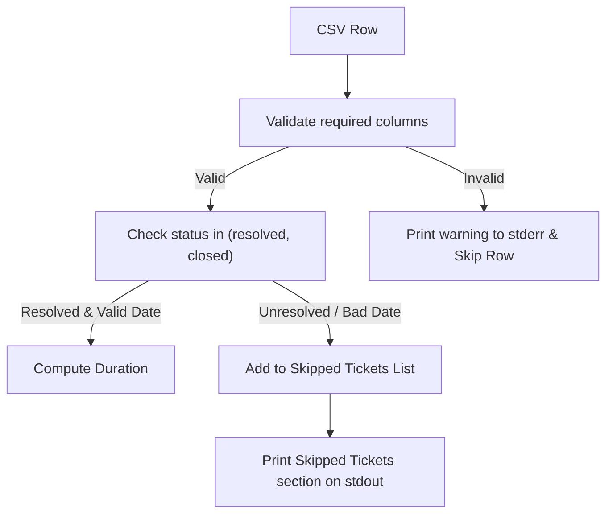

# PR 03: Row Validation, Warning Logs, and Skipped Tickets Reporting

**Branch:** `feat/03/row-validation-and-skipped-tickets` -> `dev`  
**Ticket:** [03-row-validation-and-skipped-tickets.md](file:///C:/Users/saila/Documents/BITCOT_TASK/Python-ticket-summary-tool/.scratch/ticket-summary/issues/03-row-validation-and-skipped-tickets.md)

## Summary



## Evidence

- **Before:**
  ```text
  AssertionError: assert 'Row 2: Missing ticket_id' in stderr
  AssertionError: assert 'T-102: Resolved date earlier than created date' in stderr
  FAILED tests/test_ticket_summary.py::test_malformed_rows_logged_to_stderr_and_valid_processed
  FAILED tests/test_ticket_summary.py::test_skipped_tickets_reporting_on_stdout
  ```
- **After:**
  ```text
  tests/test_ticket_summary.py::test_malformed_rows_logged_to_stderr_and_valid_processed PASSED
  tests/test_ticket_summary.py::test_skipped_tickets_reporting_on_stdout PASSED
  9 passed in 1.32s
  ```

## Merge Danger

**Door:** two-way  
Validation and warning rules are easily modified without altering storage schemas.

**Blast Radius:** low  
Warnings are directed to `stderr`, keeping standard data streams isolated.
